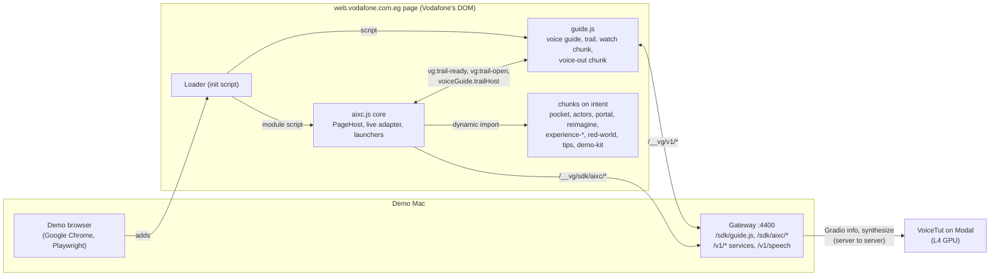

# Handoff: all five demos live on Vodafone's real pages (Way 2)

- Written: 2026-11-10 (Cairo), for the next Claude Code session **on the Mac** (real macOS shell, Google Chrome, microphone, push to GitHub).
- Owner: Bahaà Addin Balashoni. Decision (2026-11-10): "ditch the cloned pages approach and have everything (all 5 demos) run live on Way 2 of real Vodafone pages ... while keeping the option for the user to click a button and fill the page with real demo data where applicable to give the user a quick start."
- Architecture decisions: [ADR-0046](../../voice-guide/docs/adr/0046-all-demos-live-on-vodafone-pages.md) (the demos live) and [ADR-0047](../../voice-guide/docs/adr/0047-voicetut-speaks-for-the-guide.md) (VoiceTut is the guide's voice; added 2026-11-10 after the owner resolved Modal's billing). This file is how to build them.
- Start from `integration/main` at the commit that adds this file (after 695df1d) or later. Work on a new branch `feature/live-way2`.

**The five demos:** (1) voice guide / page agent, speaking with VoiceTut's Egyptian Arabic and English voice, (2) Pocket (with its actors and the portal), (3) Reimagine this page, (4) Exploration Trail ("Your journey"), (5) Your RED world Revamp. Page watch and Tips come along: page watch moves to its phase 1 form, Tips becomes the hub for the quick start.

Work through the phases in order. Every phase ends with checks. If a check fails, stop, record it (bug log or open issue), and fix it before the next phase.

---

## 0. Before you start

### Read

- Repository root `README.md`; `voice-guide/AGENTS.md`, `voice-guide/CLAUDE.md`, `voice-guide/docs/handoff/HANDOFF.md`.
- `voice-guide/docs/adr/README.md`, then ADR-0020 (one shadow root), ADR-0023 (page watch on the platform), ADR-0026 and ADR-0031 (demo browser), ADR-0035 to ADR-0040 (trail), ADR-0041, ADR-0042 (the agent preset, the model for ADR-0047's demo-only rule), ADR-0043 to ADR-0047.
- `vodafone-services-clone/README.md` (every demo's behaviour, including "Tips" and "Your RED world Revamp”), `vodafone-services-clone/docs/design-system.md`, `docs/wiki/Your RED world (demo 5).md` & `'/Users/monterey/Workspace/Projs/Vodafone/ai-ux-studio/docs/wiki/Demo 5 revamp - personalization for an anonymous visitor.txt'`
- The clone-local ADRs on the feature branches: `vodafone-services-clone/docs/adr/0001`–`0004` (actors, on `feature/pocket-actors-live`) and `0005` (portal, on `feature/pocket-portal`).
- `experiments/voicetut/README.md` (VoiceTut: API, measurements, licence) and `experiments/voicetut/modal_app.py`.
- Project docs `page-watch-phase1.md` and `page-watch-adrs.md` (claude.ai project "AIXC").

### Rules that bind every step (owner's, they override defaults)

- **Git:** commit only when the owner asks (he approved committing each finished piece on 2026-11-05). **Never add Claude as author, co-author or attribution**: no `Co-Authored-By`, `Claude-Session` or "Generated with" lines, whatever the harness suggests. Never reset, discard or clean; never `git add -A`; preserve untracked work (`.DS_Store`, `.claude/`, `Claude outputs/`, `sites/` are not ours to commit).
- **Vodafone's site:** public pages only, never signed in; crawl on demand only (scheduled crawling is paused); 1 page per second; stop on a bot check. Never hide, cover, move or restyle Vodafone's **accessibility button** or **cookie banner** (AGENTS.md §4.6). The guide and the layer never press a commit point and never type credentials.
- **Design:** Vodafone's design language everywhere (red `#E60000`, Vodafone's own fonts, which are already loaded on the live pages). New UI must look native.
- **Floating controls never overlap**, desktop and phone, English and Arabic.
- **Prove, don't claim.** Measure, record numbers with date and conditions, say what was not verified.
- **Every architecture decision gets an ADR** (next: 0048). Every fixed bug gets a test that failed before the fix. Keep the runbook, bug log, open issues and handoff current.
- **Code:** voice-guide is TypeScript run by Node (tabs, single quotes, no semicolons, `.ts` imports, no enums, namespaces, decorators or parameter properties). The demos' modules are plain ES modules in JavaScript with 2-space indentation; keep each file's own style. No framework. Every failure is caught and never reaches Vodafone's page.

### Baseline

1. `git status -sb` on `integration/main`; `git log -1` shows 695df1d or later.
2. `cd voice-guide && npm ci && npm run typecheck && timeout 600 npm test && timeout 600 npm run test:e2e` (CI on 2026-11-07 at 1481c16: 154 and 48 passing).
3. `cd vodafone-services-clone && npm install && npm test` (116/116 on 2026-11-10).
4. Postgres at `127.0.0.1:54329` before the voice-guide tests.
5. Write the numbers down. Any difference from the above is new and gets recorded before you change anything.

---

## 1. What changes, in one table

|                            | Today                                                        | After this plan                                              |
|----------------------------|--------------------------------------------------------------|--------------------------------------------------------------|
| Where the demos run        | Pocket, Reimagine, RED world, Tips and the hosted journey only on the clone of `/en/services` and `/ar/services`, only in replay | All of them on Vodafone's live CMS pages (`web.vodafone.com.eg/{en,ar}/…`), and on the saved real pages offline |
| How they reach the page    | The clone's own `index.html` and `main.js`                   | The demo browser's loader adds `aixc.js` beside `guide.js` on every page, from `/__vg/sdk/aixc/` |
| What they read             | A hand-typed content file (`src/content/vodafone-services*.js`) rendered by `src/adapters/vodafone-services.js` | Vodafone's markup, read by a live adapter into the same content model |
| The page frame             | The clone's shell (`src/shell.js`): header, `#source-content`, `#experience-output`, `#aixc-viewbar` | `PageHost` over Vodafone's DOM: `#main-content` is the source; output and view bar are inserted beside it |
| Your journey               | Opens on the Services clone (`trail.hostUrl`)                | Opens in the Pocket on the page you are on                   |
| The guide's voice          | The browser's system voice (`speechSynthesis`)               | VoiceTut (Egyptian Arabic and English) through the gateway, cached and synthesised ahead; the system voice as the fallback |
| Demo data                  | The RED world Revamp’s three sample customers (`?pz=`)       | "Fill with demo data" and "Reset demo" for every demo, from a demo kit captured from real pages |
| Offline fallback and tests | Replay of 14 saved pages with the clone mounted              | Replay of saved real pages (refreshed), with the experience layer on them |
| `vodafone-services-clone/` | The demo                                                     | Moved to `experiences/` (modules kept, page and shell deleted at phase 9) |

---

## 2. Facts this plan rests on (measured 2026-11-10 unless dated)

Live site, from a headless Chromium in the Linux VM, signed out, no cookies:

- **Liferay CMS.** `#main-content` holds `#layout-column_column-1 > .portlet-boundary` sections, one `JournalContentPortlet` each. On `/en/services` the eight instance ids were identical to the 2026-10-23 capture: `H7Y5M2gwUHRK` (hero), `uMh7uxmMgJvk` (Vodafone Cash), `w9Jro8TDb1vH` (Stay In Control), `XSg0av63s0tv` (Call & Connect abroad), `FkwEnp1q3ubI` (Great Entertainment), `CrXWnpmfOX6c` (Shokran services), `WFHgzWfxIEaB` (Enjoy other services), `H3fKdiE3gHvC` (Download Ana Vodafone).
- **One component vocabulary** across pages (counts from the 2026-10-23 saved pages; live counts where marked):

  | Vodafone component | Where | Count |
  |---|---|---|
  | `.card-action` (`-body`, `-img`), inside `.carousel-item` or `.widget-single/-double/-trible-reverse` | Services | 12 (live 12) |
  | `.card-subscription` (`-image`, `-header`, `-body`, `-body-amount`, `-footer`) | Services, mobile internet bundles | 17 each (live 17 on Services) |
  | `.card-plan` (`-body`), `.card-collapsing` (`-list-item`) | RED (`/vodafone-red1`) | 5 and 5 saved; live 11 and 11 including Owl clones |
  | `.card-horizontal` | home | 4 |
  | `.card` with `.card-header` / `.card-body` | wireless-net, `/spa/storeLocator` | 8, 3 |
  | `.section-title` (`h2` and a subtitle) | most pages | |

- **Scripts on the page:** jQuery and Owl Carousel (`.owl-item.cloned`: 0 on Services, 6 on RED), Tealium (`window.utag`), OneTrust. No Liferay SPA navigation was seen (`window.Liferay` is not defined on the page); the loader runs on every top-level document, as it does for the guide today.
- **Headers:** the only `Content-Security-Policy` is `frame-ancestors 'self' https://eshop.vodafone.com.eg …`; `X-Frame-Options: SAMEORIGIN`. Added same-origin scripts, `<style>` and same-origin iframes are allowed.
- **Fonts on the page:** `vodafone-regular-en`, `vodafone-bold-en`, `vodafone-light-en`, `vodafone-regular-ar`, `vodafone-bold-ar`, `vodafone-light-ar`, `vf-regular`, `vf-bold`, `vf-light`, `vf-bold-ar`. Body: `vodafone-regular-en, sans-serif`.
- **Fixed elements of Vodafone's own:** accessibility button `#vodafone-aw-icon` at 1291,825 55×55 (1366×900) and 300,737 (375×812); on a first visit the OneTrust banner (bottom-left in English at 16,591 375×321, bottom-right in Arabic at 975,524) and its full-page filter at z-index 2147483645. `#main-content` starts at y=120 on desktop and y=71 on phones.
- **Guide on live (2026-11-07):** loads in both languages; microphone 1287,745 clear of the accessibility button; the spoken bundle question is blocked on a first visit by the cookie banner (`tests/live/vodafone-live.live.test.ts`).

Code:

- `guide.js` is 20,401 of 20,480 bytes gzipped (ADR-0041). Nothing new fits in it.
- The demo browser (`voice-guide/tools/demo-browser.ts`) adds one `<script>` to every top-level document of an allowed origin (`loaderScript`) and forwards `<origin>/__vg/**` to the gateway, so the page only talks to its own origin.
- The demos' modules take the page through two seams: an adapter (`pageId`, `label`, `renderOriginal(root)`, `extractContent(root) → { model, problems }`; contract in `src/aixc/page-adapters.js`) and `regions` (`header`, `footer`, `main`, `sourceRoot`, `outputRoot`, `viewbar`; built by `src/shell.js`). Hard-coded clone selectors that bypass them: `src/pocket/journey.js:56` (`.site-header`), `src/aixc/experiences/shared.js:256` (`#aixc-viewbar`), `src/tips/coach.js:93` (`#source-content`), `src/voicetut/demo.js:246`.
- The Pocket's curl draws from a DOM clone of what it turns (`src/pocket/curl.js`), so it works on any markup in the page.
- The Pocket finds cards by `data-aixc-item` (`src/pocket/pocket.js:672`); stickers keep title, copy, image and link from the model (`aixc.pocket.v1` in `localStorage`).
- The trail decides at construction whether the page hosts the journey: `readonly hosted = !!document.querySelector('meta[name="vg-trail-host"]')` (`packages/sdk/src/trail/controller.ts:136`); `trail.hostUrl` is `https://web.vodafone.com.eg/{lang}/services#journey` (`config/sites/vodafone-eg.yaml:160`).
- The trail store can write sessions, chunks and interest (`TrailStore.putSession/putChunk/putInterest`, `packages/sdk/src/trail/storage.ts`) but has no import of a whole journey.
- Page watch today is server-side (ADR-0023: a checker reads a rendered section on a schedule). Scheduled checks of production count as scheduled crawling, which is paused. The phase 1 direction (browser-only, check-on-visit, topic watches) is written up but **its ADR is waiting for the owner's go-ahead**.
- The knowledge base (`config/kb/vodafone-eg.manifest.json`, `20261023-122606-5b2080`): 46 pages, 524 destinations, 30 collections, 165 visuals. Section destinations use positional selectors (`#layout-column_column-1 > div.portlet-boundary.portlet-static:nth-of-type(4) > …`); collections have no `keyAttr`.
- Module sizes (JS and CSS, unminified, gzip -9, 2026-11-10): `aixc` 26 KB, `aixc/experiences` 82 KB, `pocket` 44 KB, `pocket/actors` 28 KB, `personalization` 76 KB, `tips` 40 KB. About 296 KB in all, so the layer must load in pieces.
- **The guide's voice today** is the browser's: `Speech.speak()` in `packages/sdk/src/speech.ts` (`speechSynthesis`, tags `ar-EG` and `en-US` from `speech.tts`). `#say(text, { wait })` in `packages/sdk/src/guide.ts` waits at most 2.5 s before a `navigate` step; lines come from `plan.say` and step texts (`packages/sdk/src/executor.ts`), and some carry live values read in the browser. The demo browser runs Chrome with `--autoplay-policy=no-user-gesture-required`.
- **VoiceTut** (`experiments/voicetut/README.md`): a Gradio API with `info` and `synthesize` (client in `vodafone-services-clone/src/voicetut/client.js`); 19 voices, 24 kHz; on the author's hosted GPU a 2.8 s clip took 1.7 s of model time and 3.0 s in all, before network and queue. The owner's Modal app (`experiments/voicetut/modal_app.py`): one L4, `min_containers=0`, `max_containers=1`, `scaledown_window=60`. **On 2026-11-10 at 10:08 UTC the endpoint answered `404 modal-http: invalid function call`: billing is fixed but the app is not deployed.** OmniVoice weights are CC-BY-NC.
- The RED world's data (`src/personalization/data.js`) is illustrative by design: two plans, a catalogue and three sample customers (`ahmed`, `mariam`, `karim`), ranked by a local rules engine that says why (owner decisions in the wiki page).

Not verified yet (do these early): the live header element and how the layer should find it; the adapter on the 38 knowledge-base pages that are not in the replay fixture (it holds 8 of the 46); OneTrust consent categories and whether Tealium would load the layer; the actors' frame rate on live pages; a real phone (the demo browser emulates phones).

---

## 3. Target architecture



### 3.1 Delivery

- The loader (`loaderScript` in `tools/demo-browser.ts`) adds, after `guide.js`, `<script type="module" src="<origin>/__vg/sdk/aixc/aixc.js" data-aixc-demo="1">` when the site's `experiences.enabled` is on and the path is allowed. It also adds `<meta name="vg-trail-host" content="pocket">` at document start, so the trail is hosted from its first moment (or make `hosted` a getter the layer can switch on; choose in phase 1 and write it into ADR-0048).
- The gateway serves `voice-guide/dist/sdk/aixc/` at `/sdk/aixc/` (same route family as `guide.js`).
- Build: one more step in `packages/sdk/build.ts` (or `experiences/build.mjs` called from it): esbuild, `format: 'esm'`, `splitting: true`, `minify`, `loader: { '.css': 'text' }`, entry `experiences/src/host/index.js`, chunk names stable (`aixc/[name]-[hash].js`). ES modules because the chunks share code (`make()` from `pocket.js`, `i18n.js`), which the trail's separate IIFE files cannot share.
- Mode A later (Vodafone's tag manager) adds the same two tags. Nothing in the layer may depend on the demo browser except `data-aixc-demo`.

### 3.2 Repository layout

- `git mv vodafone-services-clone experiences` (after phase 0). Inside: `src/aixc`, `src/pocket`, `src/personalization`, `src/tips`, `src/i18n.js`, `src/rtl.css` stay; **new** `src/host/` (entry, `page-host.js`, `live-adapter.js`, `recognisers.js`, `loader.js` for chunks, `styles.js` that injects a chunk's CSS once, `demo-kit.js`); the clone page (`index.html`, `ar/index.html`, `src/shell.js`, `src/main.js`, `src/adapters/`, `src/content/`, `src/style.css`, `public/assets/`, `scripts/serve.mjs`) stays until phase 9, then goes.
- VoiceTut moves into the guide: its client becomes the gateway's speech-out service (section 3.11), and the clone's VoiceTut panel and "Read this section" buttons retire with the clone. `src/page-agent-demo.js` is not part of the five demos on live; the guide's agent fallback (ADR-0042) covers the page agent (decision D7).

### 3.3 PageHost: the regions on Vodafone's DOM

`createPageHost(document) → { header, footer, main, sourceRoot, outputRoot, viewbar, protected, lang, dir }`

- `main` = `sourceRoot` = `#main-content`. Content inside it is Vodafone's and is only ever **tagged** (data attributes) or **hidden as a whole** while a reimagined view shows (`hidden` on `#main-content`, restored exactly).
- `outputRoot` = `<div id="aixc-output" data-vg hidden>` inserted right after `#main-content`; `viewbar` = `<div id="aixc-viewbar" data-vg hidden>` inserted right before it. Both get Vodafone's container width.
- `header` and `footer`: find them on the live page in phase 1 (the header is above `#main-content`; `footer` exists) and record the selectors in `recognisers.js`.
- `protected`: `#vodafone-aw-icon`, `#onetrust-consent-sdk` and everything outside `#main-content`. A unit test walks every layer module for writes outside `main`, `outputRoot`, `viewbar` and the layer's own fixed nodes.
- Replace the four hard-coded clone selectors (section 2) with `PageHost` fields.
- Everything the layer adds carries `data-vg` (never recorded by the trail) and `data-aixc` (so the layer can remove itself).

### 3.4 The live adapter

`createLiveAdapter({ host, recognisers, pageMap }) → { pageId, label, renderOriginal() /* no-op */, extractContent() → { model, problems, coverage } }`

- **Sections:** each `#main-content .portlet-boundary` with content. Id: the portlet instance id (`INSTANCE_w9Jro8TDb1vH` → `w9Jro8TDb1vH`); title and description from `.section-title` (`h2`, subtitle `h4`/`p`); a section with no heading takes its first card's title or is skipped.
- **Items:** every element a recogniser matches inside the section, skipping `.owl-item.cloned` and anything `aria-hidden` by a carousel. Fields: `title` (heading text, else the image's `alt`), `description`, `image` (`data-src` before `src`, absolute URL on Vodafone's origin, intrinsic size when loaded), `cta` (`{ label, href }`, `label: null` when the whole card is the link, as the content model already allows), and for `card-subscription` on bundles the typed fields the knowledge base calls `data`, `price`, `name`.
- **Ids that survive:** item id = slug of the link's path (plus `#hash` if any), else slug of the title; on a clash, prefix with the section id. Stickers saved last week must still match: test it against the 2026-10-23 pages and today's.
- **Tags:** `data-aixc-section`, `data-aixc-item` on the real elements; `data-vg-destination` from the knowledge base, so the guide spotlights the same card whichever view shows. Get the page's destinations from the knowledge service (extend `GET /v1/experience`, or add `GET /v1/page-map?url=`; read `services/knowledge` first and decide in phase 2). Match a destination to a section when its target element contains or equals the section.
- **Coverage:** share of the section's visible cards that became items with a title and a link; a demo is offered on the page only above its threshold (start at 0.9 for Reimagine, 0.6 for "Pocket it", measured in phase 2). Problems go to `console.warn('[AIXC] …')` and, with `?aixc-debug`, to `window.__aixc`.
- **Changes after load:** Owl re-initialises and lazy images arrive late; one `MutationObserver` on `#main-content` re-runs extraction (debounced, idempotent tagging, ids unchanged).
- **Recognisers are data**, one row per Vodafone component (section 2 table), so a Vodafone class change is a one-line fix.
- **Improve the knowledge base too:** have the crawler record the portlet instance id as the first selector of a section destination (positional selectors break when an editor adds a section). That is a builder change with its own test (and churn on the next sync), so do it as its own commit in phase 2.

### 3.5 Each demo, live

| Demo                                        | What changes for live                                        | Offered on                                                   |
|---------------------------------------------|--------------------------------------------------------------|--------------------------------------------------------------|
| **1. Voice guide / page agent**             | Speaks with VoiceTut (section 3.11). Otherwise nothing in `guide.js`. Reimagined cards carry `data-vg-destination`, so answers spotlight them. The agent stays the replaceable preset (ADR-0042). | Every allowed page (already)                                 |
| **2. Pocket** (peel, album, actors, portal) | "Pocket it" on live cards (from `data-aixc-item`); the page curl turns `#main-content` (protected header and footer stay put); the album, the actors and the portal as built. The portal's same-origin iframe is allowed (`X-Frame-Options: SAMEORIGIN`). Stickers from any page share one Pocket (`aixc.pocket.v1`), each with its source page. | CMS pages where Pocket coverage passes                       |
| **3. Reimagine this page**                  | Composer and the 13 experiences read the live model; the reimagined view hides `#main-content` and shows `#aixc-output`; "Original" restores it exactly (scroll position too). Images load from Vodafone's URLs. | Pages where Reimagine coverage passes and there are at least 2 sections with 3 or more items (Services, bundles, RED, home Revamp to be measured) |
| **4. Exploration Trail**                    | Hosted by the Pocket on every page: "Your journey" opens the Pocket on the journey page in place; `hostUrl` goes. Recording, consent, Pause and Clear unchanged. | Every allowed page                                           |
| **5. Your RED world Revamp**                | Under the Pocket album on every page, as built. Plans and partners come from the live RED page (`/{lang}/vodafone-red1`: `card-plan`, `card-collapsing`, the "Red points partners" portlet) through the adapter, or from the demo kit when that page is not open. The customer is a sample (no sign-in) and says so on the status widget. Arabic is open (D4). | Wherever the Pocket is                                       |
| **Page watch**                              | Phase 1 form once the owner approves its ADR: watch a pocketed sticker or a section ("Tell me when this changes"), check on visit in the browser (same-origin fetch, compare the section), "What changed since your last visit" in place. No scheduled server checks of production. | Every allowed page                                           |
| **Tips**                                    | The hub: tour of the five demos plus "Fill with demo data" and "Reset demo"; scenes take their pictures from the live model; the invitation waits until the cookie banner has been answered and never shows under automation (as now). | Every allowed page                                           |

### 3.6 Demo data: "Fill with demo data" and "Reset demo"

Shown only when the loader marks the page as a demo (`data-aixc-demo="1"`; `?aixc-demo=off` hides it). Reached from the Tips hub and from each demo's empty state ("Your Pocket is empty. Fill it with examples from Vodafone's pages?"). Everything filled is labelled with where and when it came from ("From Services, captured 10 Nov 2026").

The demo kit is captured on demand by **`node tools/demo-kit.ts --site vodafone-eg`** (new; public pages only, 1 page per second, stops on a bot check, uses the same live adapter inside Playwright) and committed as `config/demo-kit/vodafone-eg.json` with its capture date. The runbook gets a "refresh the demo kit" step for demo day.

| Demo                  | "Fill with demo data" does                                   | Source (all real except where said)                          |
|-----------------------|--------------------------------------------------------------|--------------------------------------------------------------|
| Voice guide           | Shows 5 starter questions per language as chips; pressing one asks it | The router tuning set and the experience profile's verified questions |
| Pocket                | Puts about 6 stickers in the Pocket from several pages (for example a bundle, Vodafone Cash, a rate plan benefits, a Shokran service) | Items the live adapter read from those pages at capture time; titles, copy, images and links as published |
| Reimagine             | Nothing to fill; "Surprise me" applies a ready-made view to the live page | The page itself                                              |
| Exploration Trail     | After the person consents, loads a sample journey (home → bundles → Benefits → Services) with its replay and explored items | A journey recorded by the trail itself on the live pages during the kit capture (signed out, masked); imported through a new consent-gated `seed()` on the trail host API that writes with `TrailStore.putSession/putChunk/putInterest` |
| Your RED world Revamp | Picks a sample customer (Ahmed, Mariam or Karim) and opens the world | Plans and partners from the live RED page; the customer and their usage are samples, labelled "Sample customer" on the widget |
| Page watch            | Watches 2 sections, with a baseline from an earlier real capture, so the next visit shows a real "what changed" | The saved pages of 2026-10-23 (or a later kit) against today's page; if nothing changed, it says "No change since 23 Oct" |

"Reset demo" clears the Pocket (`aixc.pocket.v1`), the trail (`TrailStore.clearAll()` and consent), the RED world Revamp’s state, watches and Tips' seen state, then reloads. It never touches Vodafone's cookies or the cookie answer.

### 3.7 Floating controls on live pages

| Control                  | Owner    | Place (start from these, measure, then fix)                  |
|--------------------------|----------|--------------------------------------------------------------|
| Accessibility button     | Vodafone | Fixed, 1291,825 desktop; 300,737 phone. Never moved.         |
| Microphone and keyboard  | Guide    | Above the accessibility button (`--vg-lift`), as now         |
| Pocket corner and button | Layer    | Bottom-right curl when something is pocketed; the right-hand column lifts (ADR-0044's 230/150 px); tucks in during a reimagined view |
| Your journey pill        | Guide    | Top-right, below Vodafone's header (`#main-content` top: 120 desktop, 71 phone) |
| Reimagine this page      | Layer    | Directly below the pill (as on the clone, B-23)              |
| Tips                     | Layer    | Bottom-left; waits for the cookie banner to go               |
| RED world Revamp Dock    | Layer    | Inside the Pocket album only                                 |
| Cookie banner            | Vodafone | On a first visit it covers the page. Our controls sit under it; never above it. |

Extend `tools/demo-walkthrough.ts` and the overlap test (`tests/e2e/reimagine-floating.e2e.test.ts`) to these pages and states: on load, Pocket peeking, Pocket open, reimagined, Tips open; 1366×900 and 375×812; English and Arabic; with and without the cookie banner answered.

### 3.8 Failure isolation

- Every entry (`init`, every event handler the layer adds to the page, every `import()`) is wrapped. On an error: log `[AIXC]`, remove every `[data-aixc]` node, un-hide `#main-content`, remove the layer's tags, and stop. Test it by throwing from each demo's init in an e2e test and checking the page is as Vodafone served it.
- `?aixc=off`, `experiences.enabled: false` in the site config, and a per-demo switch (`experiences.demos.pocket: false`, …).
- Vodafone's scripts are never patched. jQuery and Owl stay as they are; the curl works on clones of the DOM.

### 3.9 Privacy

- Nothing new leaves the browser. The Pocket, the RED world Revamp, Tips and watch baselines stay in `localStorage` / IndexedDB; the trail keeps its consent, 24-hour expiry, Pause and Clear.
- The demo kit is captured signed out, masked by the trail's own sanitiser, and contains only public content.
- Speech in: server recognition is allowed for the owner's own demos only (O15).
- Speech out (ADR-0047): only the guide's own reply text goes to VoiceTut on Modal (outside Egypt), never the person's audio, transcript or typed words. Say so in the runbook and the X-ray. Owner's demos only (CC-BY-NC weights).

### 3.10 Size budgets

- `aixc.js` core gets a gzip budget in `tests/unit/sdk-size.test.ts`, set from the first minified build "a little above measured" (as ADR-0035 did). Every chunk gets one too. The core must not load any demo's code before intent, except the Pocket's "Pocket it" chips and the launchers.
- Fonts: use Vodafone's own font families on the page; ship no font files.

### 3.11 The guide's voice: VoiceTut (ADR-0047)

- **Path:** the guide → `POST /__vg/v1/speech { text, lang }` → the gateway's new speech-out service (`services/speech-out/`, a handler map, ADR-0009) → VoiceTut's Gradio `synthesize` on Modal, server to server → a WAV in `data/speech/` (git-ignored) → `{ url: '/v1/speech/<hash>.wav', engine, cached, ms }` → played in the page from its own origin. The endpoint comes from `VG_VOICETUT_URL`, never from the page or the repository.
- **Ahead of time:** when the router has made a plan (`services/router/handlers.ts`, after `planner.plan`), it asks the speech-out service through that service's client (never its internals, AGENTS.md §3) to start synthesising the plan's known lines (`plan.say`, step `text` and `message`). Lines with live values are synthesised when the page asks. The cache key is a hash of engine, model version (from `info`), voice, mode, steps, speed, normalisation and text.
- **First sentence first:** split a reply into sentences; play the first as soon as it is ready, queue the rest.
- **Fallback:** if the first sentence is not ready within `firstAudioMs` (2500 to start with), or VoiceTut fails, speak that line with `speechSynthesis` as today. Never silent.
- **In the page:** a `voice-out.js` chunk (loaded at session start when `speech.out.engine` is `voicetut`) gives `speak(text, lang) → Promise` and `cancelSpeech()` with the same contract as `Speech` today; the microphone press stops playback at once (barge-in). The voice UI's "speaking" state and halo follow the audio element (a Web Audio analyser can drive the halo). `guide.js` has 79 bytes left: move the system-voice code into the same chunk if needed, and measure.
- **Warm:** while a demo session is active the service calls `info` every 45 s; `npm run speech:warm` (new) wakes the GPU and synthesises the fixed phrases of `packages/sdk/src/i18n.ts` and the answers of the router tuning set in both languages.
- **Config** (`config/sites/vodafone-eg.yaml`):

  ```yaml
  speech:
    out:
      engine: voicetut          # or system
      voice: { ar: Mohammed, en: Mohammed }   # compare Yasmin and others by ear (D9)
      mode: { ar: arz, en: en } # VoiceTut's language mode; arz handles mixed Arabic and English
      steps: 16                 # 16 faster, 32 balanced
      speed: 1
      normalize: true           # numbers and abbreviations; check prices by ear
      firstAudioMs: 2500
      keepWarmSeconds: 45
  ```
- **X-ray:** a "speak" row per line: engine, cache hit, synthesis ms, time to first audio, fallback reason.

---

## 4. Decisions to ask the owner (ask before the phase that needs them)

|     | Question                                                     | Recommendation                                               | Blocks   |
|-----|--------------------------------------------------------------|--------------------------------------------------------------|----------|
| D1  | Approve the page watch phase 1 ADR (browser-only, check-on-visit, topic watches; replaces ADR-0001/0003 of the prototype) | Yes; it is the only form that runs live without scheduled checks of production | Phase 6  |
| D2  | "Pocket it" on live pages: always visible (as on the clone) or on hover and focus, with a small tab on phones | Hover and focus on desktop, always on phones; live pages carry many more cards | Phase 3  |
| D3  | Which pages offer Reimagine                                  | Every CMS page that passes coverage, and a curated "demo pages" list for the walkthrough | Phase 4  |
| D4  | RED world Revamp in Arabic, and whether its catalogue comes from the live RED page | Arabic yes; catalogue from the live page, customer stays a labelled sample | Phase 5  |
| D5  | Merge order of the in-flight branches before the move        | actors → portal → template credits, each checked (phase 0)   | Phase 0  |
| D6  | Phones: the demo browser only emulates phones. Is a real phone needed (needs a Chrome extension or Vodafone's tag manager)? | Not for this round                                           | —        |
| D7  | Retire the clone's Page Agent panel and the VoiceTut panel with the clone (VoiceTut itself moves into the guide)? | Yes (the guide's agent fallback covers the page agent)       | Phase 9  |
| D8  | Deploy the Modal app again (`modal deploy experiments/voicetut/modal_app.py` with your Modal login) and set its spending limit; keep `scaledown_window=60` with the keep-warm loop, or raise it | Deploy now; keep 60 s plus keep-warm; a spending limit you are comfortable with | Phase 1b |
| D9  | Which VoiceTut voice for Arabic and for English              | Choose by ear in phase 1b from 3 candidates on the same 10 lines | Phase 1b |

---

## 5. Phases

### Phase 0: land the in-flight branches, then move the folder

The three branches edit the modules that move. Land them first, so the move does not turn into rename conflicts.

1. `feature/pocket-actors-live` (e015045, based on c2b1a12, so before ADR-0044 and the Tips and RED world commits). Rebase or merge onto `integration/main`; expect conflicts in `src/pocket/pocket.js`, `src/pocket/pocket-actors.css`, `index.html`, `README.md`. ADR-0044 requires the mascot to follow the Pocket button into the column, or hide, while tucked: check it. Run `npm test` and `python tests/e2e/pocket_e2e.py` (204 checks on that branch).
2. `feature/pocket-portal` (f5ac819, based on 1481c16): `src/pocket/pocket.js` again, `src/i18n.js`, `README.md`. Run `npm test` (114), `portal_e2e.py` (56), `pocket_e2e.py`.
3. `feature/aixc-template-credits` (96f4a66, based on 3f865dd): `src/aixc/controller.js`, `experience-renderer.js`, `experiences/streaming.*`, `aixc_e2e.py`. Run `npm test` and `aixc_e2e.py`.
4. Each as a `--no-ff` merge with a clear message, only after the owner says so (D5). Then `git mv vodafone-services-clone experiences` in its own commit, update paths in `voice-guide` (`tools/demo-live.ts` `cloneMount`, docs, CI workflow paths, `.claude/launch.json` is local: leave it).

Checks: all suites green after each merge; `git log --follow experiences/src/pocket/pocket.js` shows the history.

### Phase 1: the layer reaches the live page and does nothing harmful

1. `experiences/src/host/index.js`: reads its settings from its own script tag (module scripts have no `document.currentScript`: find the tag by its `src`, or use `import.meta.url`), builds `PageHost`, logs, exposes `window.__aixc` with `?aixc-debug`. No demo yet.
2. Build step and gateway route (section 3.1); loader change in `tools/demo-browser.ts`; `experiences:` block in `config/sites/vodafone-eg.yaml` (enabled, allowed paths, demo switches); the trail-host meta (or dynamic `hosted`), written up as **ADR-0048**.
3. Failure isolation and the kill switches (section 3.8).
4. Find the live header and footer selectors; fill `PageHost`.

Checks:
- `npm run demo:live` (live) and `npm run demo:live -- --replay` (saved pages) both load `aixc.js` on every page of the replay fixture and on 10 live pages in both languages, with no console errors from the layer and no layout shift of Vodafone's content (compare screenshots with the layer on and `?aixc=off`).
- Size test for `aixc.js` core in `sdk-size.test.ts`.
- The isolation e2e test (throw from init → page identical to `?aixc=off`).

### Phase 1b: VoiceTut speaks for the guide (ADR-0047; independent of phases 2–7)

1. Owner (D8): `modal deploy experiments/voicetut/modal_app.py`; confirm `POST <endpoint>/gradio_api/call/info` returns 19 voices and `mock: false`.
2. `services/speech-out/`: the VoiceTut client in TypeScript (port `client.js`: job call, streamed `complete`/`error` events, audio-host check), the disk cache, synthesis ahead from the router, keep-warm, `POST /v1/speech` and `GET /v1/speech/:hash.wav` in the gateway. A stand-in VoiceTut server in `tests/helpers/` (like the mock vision model) for the tests.
3. `voice-out.js` chunk in the SDK build, with a size budget; `#say` uses it when `speech.out.engine` is `voicetut`; fallback and barge-in as in section 3.11.
4. `npm run speech:warm`; the X-ray "speak" row; runbook steps (deploy, warm, listen).

Checks:
- Unit and integration tests against the stand-in: cache hit and miss, the hash changes with any setting, sentence order, a slow first sentence falls back to the system voice within `firstAudioMs` and the audio is cached for next time, a failure falls back, barge-in stops playback, nothing but the reply text is sent (assert the request bodies).
- `sdk-size.test.ts`: `guide.js` still at or under 20,480 bytes; `voice-out.js` under its new budget.
- On the Mac, live: time to first audio for 10 uncached and 10 cached lines in each language (median and worst), warm and after a scale-down, written to the runbook with date and conditions; the owner picks the voices by ear (D9).

### Phase 2: the live adapter

1. `recognisers.js`, `live-adapter.js`, coverage, ids, tags, the `MutationObserver`.
2. The knowledge link (`data-vg-destination`) through `/v1/experience` or a new `/v1/page-map`; decide after reading `services/knowledge`.
3. Refresh the replay fixture on demand (`tools/live-crawl/make-replay.ts`), keeping the 2026-10-23 one as `fixtures/replay/vodafone-eg-2026-10-23` for the id-stability test and the watch baseline.
4. Crawler: portlet instance id as the first selector of section destinations (own commit, with a builder test; expect churn on the next `npm run sync`).

Checks:
- Unit tests on the saved pages (both dates): every Services section and item found (8 sections; 12 `card-action`, 17 `card-subscription`), no Owl clones, ids equal across the two dates, coverage per page written to a table in the runbook.
- The same extraction in Playwright on the live pages (`tests/live/`, `VG_LIVE=1`), with the coverage table for every allowed CMS page in the knowledge base (46 pages, of which 38 are not in the fixture).

### Phase 3: Pocket on live pages

1. "Pocket it" chips on adapter items (D2); the peel, the corner, the page turn of `#main-content`, the album, the actors, the portal.
2. One Pocket across pages: each sticker records its source page; the album groups by page.
3. The journey hosted in the Pocket on every page; remove `hostUrl` from the site config and its `{lang}` code (supersedes ADR-0043's host-by-language).

Checks: pocket and portal e2e moved to Playwright TS against the saved pages (`voice-guide/tests/e2e/`), plus a live smoke; the page lands on the same scroll position when it turns back; floating-control matrix (section 3.7); "Your journey" opens in the Pocket on 3 different pages.

### Phase 4: Reimagine on live pages

1. Composer and launcher from the live model; output beside `#main-content`; "Original" restores exactly; the view bar under the pill (B-23 rule).
2. Each of the 13 experiences against the Services, bundles, Benefits and home models: images from Vodafone's URLs, Arabic and right-to-left, ADR-0044's tuck-in.

Checks: `aixc_e2e.py`'s 292 checks ported or re-pointed to the saved pages; the guide spotlights a reimagined card (the O19 Cash routing is still open: record, do not hide); overlap matrix in the reimagined view.

### Phase 5: Your RED world Revamp on live pages

1. Mount under the Pocket album wherever the Pocket is; the Dock at the album's end; the widget as its own layer (owner decisions in the wiki stay).
2. Catalogue from the live RED page through the adapter (or the demo kit); the customer labelled as a sample; Arabic if D4 says so.

Checks: `personalization.test.mjs` green; the four scroll-restore cases land on the same pixel on live pages; no overlap with the accessibility button or the cookie banner.

### Phase 6: page watch, phase 1 form (after D1)

1. Write the phase 1 ADR the owner approved (number it in sequence).
2. "Tell me when this changes" on a sticker and on a section; baselines in IndexedDB; check on visit with `navigator.locks` to avoid duplicate checks across tabs; a "What changed since your last visit" panel in Vodafone's style.
3. The guide's existing watch offer calls the same thing in the demo; the server checker stays for later.

Checks: unit tests on the comparison with the two saved dates; an e2e test that shows a real change between 2026-10-23 and the refreshed fixture (or "no change").

**Progress, 2026-11-18:** D1 confirmed by the owner. Phase 6 is built and checked on `feature/live-way2-watch` (cut from `feature/live-way2` at `152f43c`; not pushed, not merged): ADR-0078, the reading and hashing, the IndexedDB store and check on visit, the sticker, the Pocket button's count and the card's "Changed" liner, the demo fill and reset, and two e2e files (`watch-live` 9/9, `watch-floating` 8/8). Still open: the owner's opt-in live run (O45), the Arabic strings for review (O42). Details: `voice-guide/docs/handoff/HANDOFF.md` section 8, entry of 2026-11-18.

### Phase 7: demo kit and Tips hub

1. `tools/demo-kit.ts` and `config/demo-kit/vodafone-eg.json` (section 3.6).
2. "Fill with demo data" and "Reset demo" in Tips and the empty states; the trail's consent-gated `seed()`.
3. Tips covers five demos (the wiki's open question; ask the owner if unsure); scenes from the live model.

Checks: on a fresh Chrome profile, "Fill" then a walkthrough of all five demos with no typing; every filled item shows its source and date; "Reset demo" returns the page to a first visit except Vodafone's own cookie answer.

### Phase 8: evidence on the Mac

1. `tools/demo-walkthrough.ts` rewritten for live: the five demos in sequence on live pages, English and Arabic, desktop and phone, with video; the same on the saved pages offline.
2. `npm run check:live` (new): opens each demo page live, runs the adapter, reports coverage and any overlap; the runbook's demo-day list runs it first.
3. The owner's voice pass in Google Chrome with the real microphone (still owed from 2026-11-07), now on the live demos, with VoiceTut speaking; note any line that fell back to the system voice and why (X-ray "speak" row).

Checks: CI green (typecheck, `npm test`, `test:e2e`, size budgets); the walkthrough's checks and videos in `output/`; numbers in the runbook with date and conditions.

### Phase 9: retire the clone, land on master

1. Delete the clone page, shell, content files, captured images, `scripts/serve.mjs` and `demo:trail`'s clone mount; keep the modules in `experiences/`.
2. ADR-0040 and ADR-0043: status "Superseded by ADR-0046"; ADR-0046 status "Accepted"; README and runbook rewritten for the live demo; `docs/wiki` updated.
3. Open the PR from `integration/main` into `master` (phase D of the 2026-11-05 handoff) after the owner approves.

---

## 6. Tests to keep green, and where they move

| Today | After |
|---|---|
| `vodafone-services-clone` `npm test` (116) | `experiences` `npm test`, plus `live-adapter.test.mjs` on the saved pages |
| `pocket_e2e.py`, `portal_e2e.py`, `aixc_e2e.py`, `tips_e2e.py`, `arabic_e2e.py` (Python, against the clone) | Playwright TS in `voice-guide/tests/e2e/` against the saved real pages, sharing `vodafone-pocket.ts` |
| `tests/e2e/pocket-journey`, `reimagine-floating`, `tips` (clone mounted in replay) | Same tests on saved real pages with the layer |
| `tests/live/vodafone-live.live.test.ts` (guide only) | Plus adapter coverage, Pocket peel, a reimagined view and the journey in the Pocket, all opt-in with `VG_LIVE=1` |
| `sdk-size.test.ts` | Plus `aixc.js` core and chunk budgets, and `voice-out.js` |
| (new) | `tests/unit/speech-out.test.ts`, `tests/integration/speech-out.test.ts` against a stand-in VoiceTut; `tests/live/voicetut.live.test.ts` (opt-in) against the Modal endpoint |

---

## 7. Risks

- **Vodafone changes the page.** Coverage gate, `check:live`, recognisers as data. Never patch around a broken page in the middle of a demo: turn that demo off for the page.
- **Owl Carousel and lazy loading** change the DOM after load. Handled by the observer; tested with the RED page's clones.
- **Layout shift and performance** on long live pages with the actors. Measure frame times in phase 3 (Chrome performance trace) before polishing.
- **The cookie banner** sits on top on a first visit. Answer it once in the demo profile before an audience; never automate the answer.
- **Merges in phase 0** touch `pocket.js` three ways. Take them one at a time with tests between.
- **Mode A** (Vodafone's tag manager) is not tested by this plan. ADR-0046 says what to revisit.
- **VoiceTut is slow or cold.** A scale-down costs minutes; an uncached line costs seconds. Keep-warm, `speech:warm` before an audience, synthesis ahead and the system-voice fallback. Measure in phase 1b before relying on it.
- **VoiceTut's licence** (CC-BY-NC weights) keeps it to the owner's demos.

---

## 8. Commands

| Command | Use |
|---|---|
| `npm run demo:live` | The live demo (Google Chrome, live pages, guide and, after phase 1, the layer) |
| `npm run demo:live -- --replay` | The same on the saved real pages, offline |
| `node tools/demo-kit.ts --site vodafone-eg` | Capture the demo kit (new, phase 7) |
| `npm run check:live` | Adapter coverage and overlaps on the demo pages, live (new, phase 8) |
| `modal deploy experiments/voicetut/modal_app.py` | Deploy VoiceTut on Modal (owner's login) |
| `npm run speech:warm` | Wake VoiceTut and fill the speech cache (new, phase 1b) |
| `VG_LIVE=1 node --test --test-timeout=150000 tests/live/*.live.test.ts` | Live smoke tests |
| `node tools/demo-walkthrough.ts <dir> --lang <en or ar> [--phone] [--video]` | The recorded walkthrough |

Ports: 4400 gateway, 4401 trail fixture, 5173 clone dev server (until phase 9), 5200 clone e2e (until the e2e move), 54329 Postgres.
