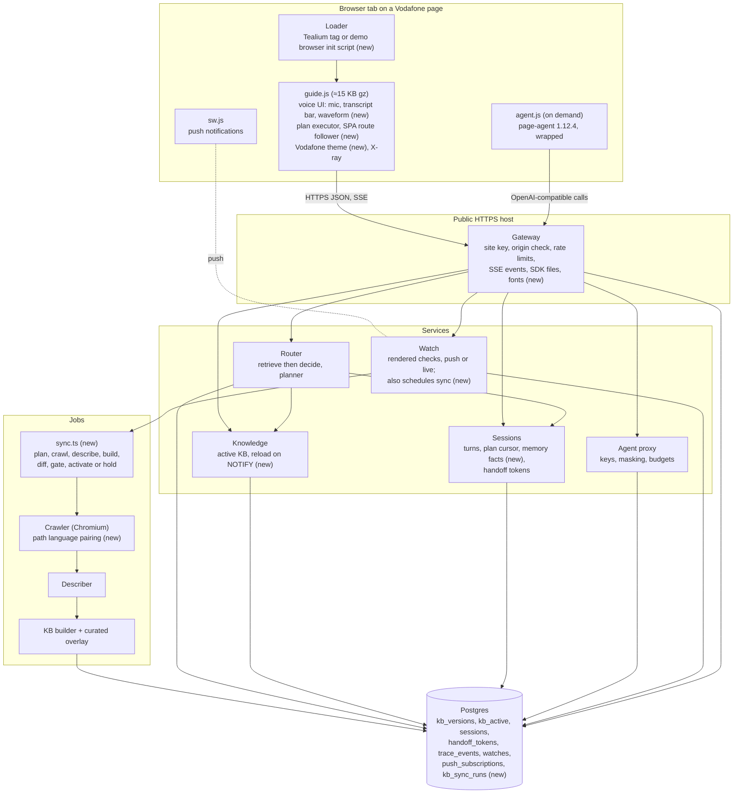

# 02 Containers

Deployable parts and their connections. Services run in one process (`VG_SERVICES=local`) or separately over HTTP (`VG_SERVICES=http`) with the same handlers (ADR-0009). New parts in this phase are marked **new**.

