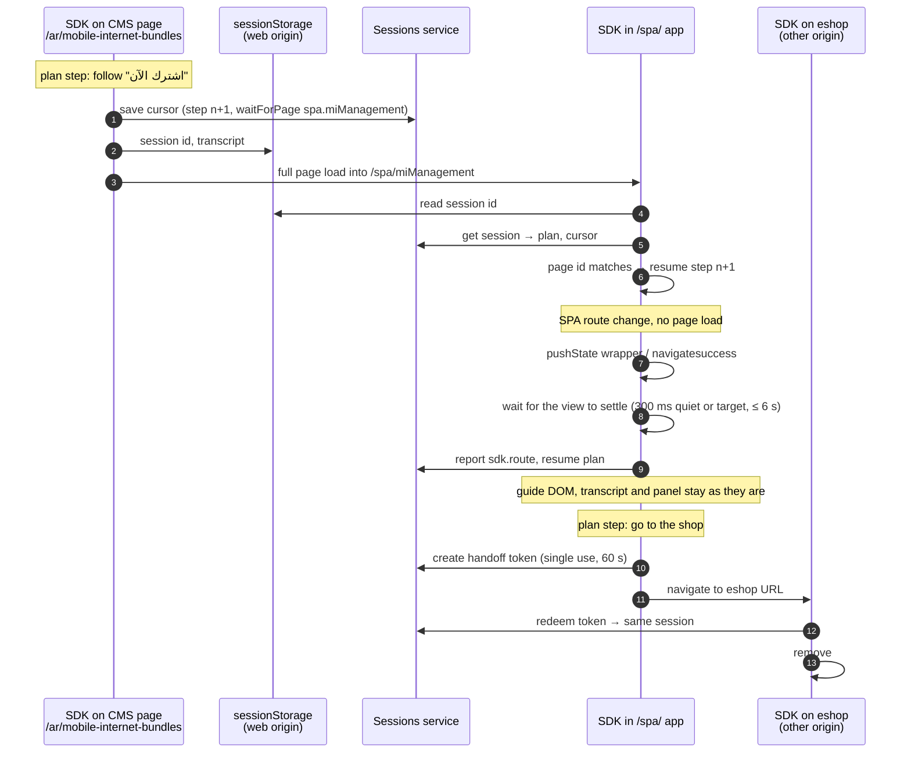

# 04 Continuity across CMS pages, the SPA and the shop

How one conversation survives every kind of move (ADR-0016, ADR-0030, SPEC-05).

| Move | Page load? | State carried by |
|---|---|---|
| CMS → CMS | yes | `sessionStorage` + server session |
| CMS → SPA | yes | same |
| SPA → SPA | **no** | in-memory SDK state + route follower |
| web → eshop | yes, new origin | handoff token + server session |
