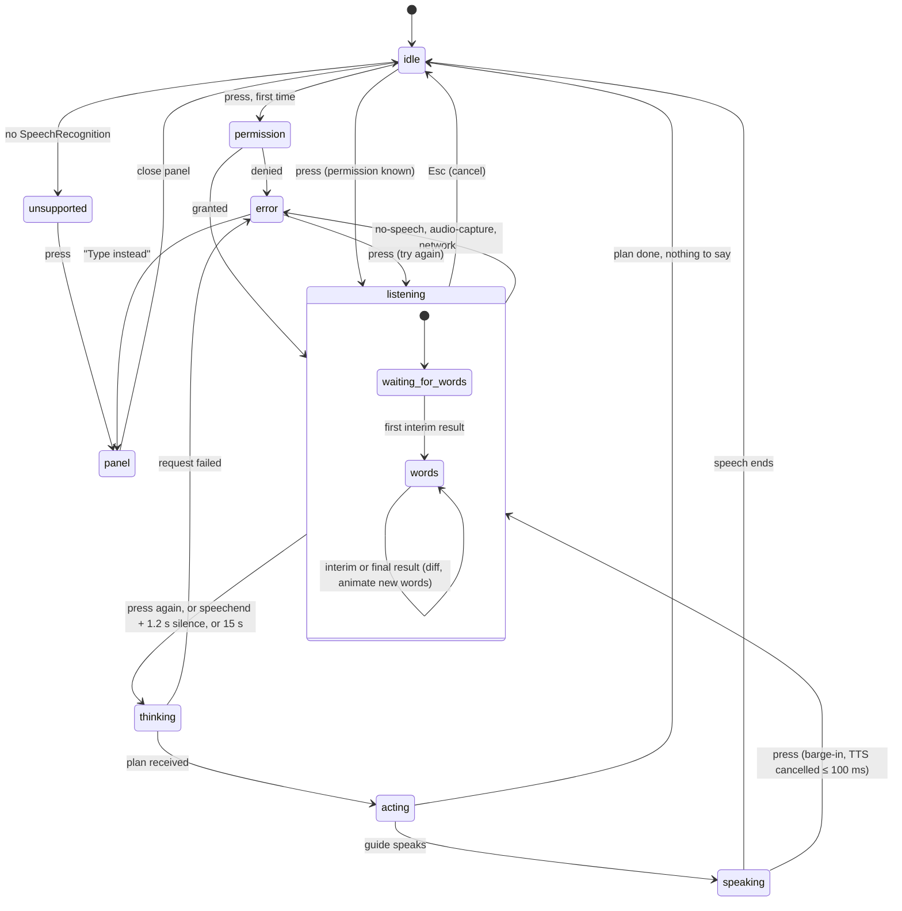

# 06 Voice UI states

The microphone button and transcript bar (SPEC-02 §3).

| State | Button | Halo | Bar |
|---|---|---|---|
| idle | microphone | none | hidden |
| permission | microphone | slow pulse | permission hint |
| listening | stop square | follows the voice level | words and waveform |
| thinking | three dots | none | final words, light sweep |
| acting / speaking | speaker | white ring on word boundaries | collapsed; answer bubble shows |
| error | microphone with slash | none | reason and "Type instead" |
