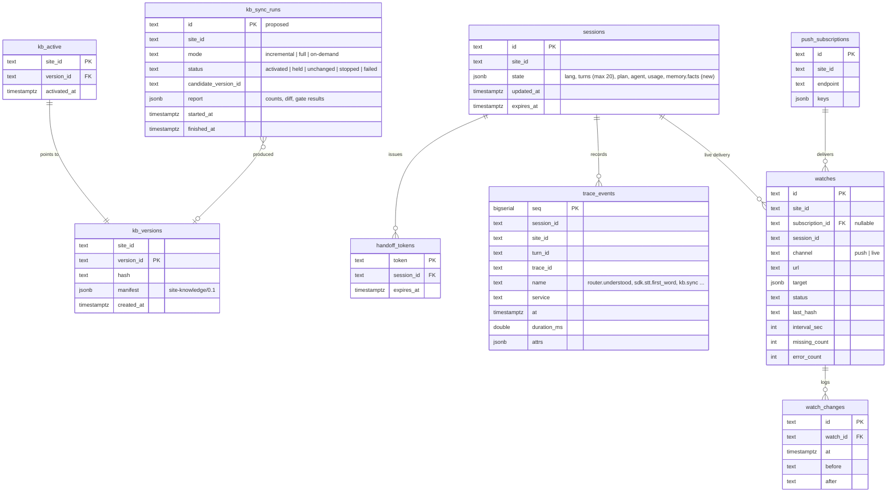

# 07 Data model

The Postgres tables (`services/shared/store/schema.sql`, version 2). `kb_sync_runs` is **proposed** for SPEC-04 (task T-205); the session's `memory.facts` live inside `sessions.state` (task T-302).

Also in the schema: `schema_info` (migration version), `cache` (describer and other caches by namespace and key) and `usage_counters` (agent budgets).
