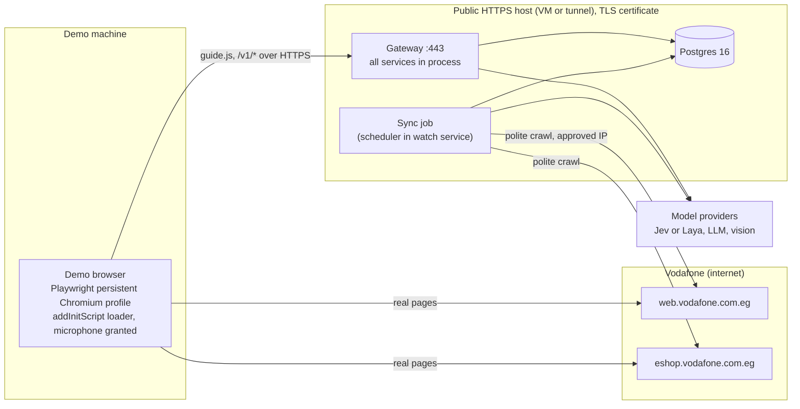
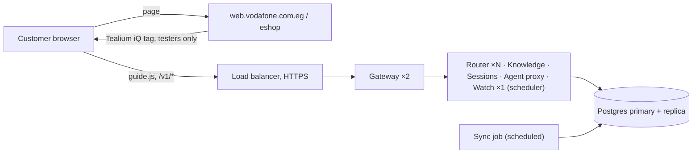

# 08 Deployment

## Demo (mode B, ADR-0026)

Fallback on stage: the same laptop runs `npm run dev -- --site vodafone-clone` against local Postgres (no internet needed except for speech recognition, which can be on-device where supported).

## Pilot (mode A)

